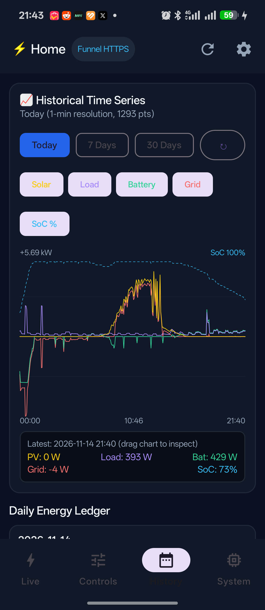

# GivEnergy Local Control (`v1.4.1`)

Local, cloud-free monitoring, control, and historic telemetry server for **GivEnergy Hybrid Inverters, Batteries, and EV Chargers**, designed to run 24/7 on a **Raspberry Pi** (Pi 400, Pi 4, Pi 5, etc.) with a standalone **Windows Deployment Installer**.


---

## Key Features

- **100% Local Modbus TCP Control** — Direct local communication with GivEnergy Hybrid Inverters (`:8899`) and EV Chargers (`:502`) with no cloud dependency.
- **Smart EV Charger Modes (Solar / Hybrid / Grid)** — Dynamic excess-solar EV charging with configurable **Solar Export Split %**, **Max Battery Discharge Power to EV**, automatic Solar start/stop, and schedule-safe full-power operation for timed/overnight tariffs.
- **Real-Time Power Flow & Live Dashboard** — Responsive web UI (desktop & mobile) with WebSocket updates, live power flow schematic (showing house-only Home Demand while keeping EV load in historic totals), KPI cards, double-height 2-hour timeline chart (backfilled from 1-minute SQLite history on startup), configurable polling rate (`5s` / `10s` / `15s` / `30s` / `1m`), and a **Clock Sync & Connection** panel displaying local time alongside Inverter and EV Charger RTC clock drift.
- **Historic Telemetry (Storage-Safe SQLite WAL)** — Configurable RAM-batched writes for MicroSD wear-protection (`60s` flush + volatile journald logs) or NVMe/USB SSD tuning (`15s` flush + `fstrim`), with **Days / Weeks / Months / Years** energy aggregation views and interactive bar-chart hover tooltips.
- **Battery & BMS + Grid Voltage Views** — Per-cell voltage monitoring, BMS status, and grid voltage history charts.
- **Auto-Discovery & Property Setup** — Automatically scans your local `/24` subnet for GivEnergy Inverters and EV Chargers on first setup and saves configuration to `property_config.json`.
- **UK Energy Cost, Tariff Monitoring & What-If Comparison** — 3-tier tariff engine supporting Custom Flat/Dual/ToU rates, UK Supplier Presets (E.ON, EDF, British Gas, OVO, Octopus), and Octopus Energy's live half-hourly API with automatic regional Ofgem Price Cap comparison, a **Days / Weeks / Months / Years / All-Time** Cost & Export Ledger, and a **Tariff Comparison (What-If Calculator)** to compare UK presets and saved custom off-peak quotes against your active tariff.
- **System Backup & Restore** — Portable `.zip` export and validated import of property/tariff configuration and the historic SQLite database for backups or Raspberry Pi hardware replacement.
- **Raspberry Pi System & Maintenance Tab** — Displays detected Pi hardware model, CPU temperature, RAM/storage usage, OS software updates with live progress, reboot-required detection, and Restart / Shut Down actions.
- **Optional Tailscale Remote Access & Funnel** — Guided Tailscale + Tailscale Funnel HTTPS setup with automatic Bearer Token authentication and QR code pairing for secure off-site and Android app access without router port-forwarding or running a VPN client on your phone.
- **Android Companion App (`givenergy-local-control.apk`)** — Native Jetpack Compose Android app with live power flow, battery/BMS & grid voltage details, interactive historical time-series graphs, UK energy cost & tariff ledger, and one-scan QR pairing.
- **Standalone Windows Installer (`GivEnergy-Local-Control-Installer.exe`)** — Full Pi software installation and configuration from the deployment PC with DPAPI-encrypted credential persistence.

---

## Quick Start (Windows)

1. Download **`GivEnergy-Local-Control-Installer.exe`** from the [**v1.4.1 Release**](https://github.com/mikekwarner/GivEnergy-Local-Control/releases/tag/v1.4.1).
2. Double-click `GivEnergy-Local-Control-Installer.exe` and follow the 6-step wizard:
   - **Step 1:** Prepare a Raspberry Pi OS Lite SD/SSD card using Raspberry Pi Imager (auto-detected if installed).
   - **Step 2:** Auto-detect Raspberry Pis on your local network (also shows currently installed version & available upgrades).
   - **Step 3:** *(Optional)* Pre-configure your UK Import/Export energy tariff (Custom Flat/Dual, UK Supplier Preset, or Octopus Energy live API).
   - **Step 4:** Enter SSH credentials (optionally remembered securely on your PC via Windows DPAPI), choose Tailscale remote access, select MicroSD vs. NVMe/SSD optimization, and optionally wipe previous data/config.
   - **Step 5:** Automated provisioning, Python environment setup, Tailscale login link, and `systemd` service deployment.
   - **Step 6:** Open the dashboard directly to **⚙ Property Setup** to verify auto-discovered Inverter and EV Charger IPs.

---

## Android Companion App

1. Download **`givenergy-local-control.apk`** from the [**v1.4.1 Release**](https://github.com/mikekwarner/GivEnergy-Local-Control/releases/tag/v1.4.1) and install it on your Android phone (enable *Install unknown apps* if prompted).
2. Enable **Tailscale Funnel** during Step 4 of the Windows Installer (or view your pairing details in the dashboard under **⚙ Property Setup → Remote Access**).
3. Open **GivEnergy Local Control** on your phone and scan the **QR Code** (or paste your Funnel HTTPS URL and Bearer Token) to pair.



---

## Running or Building from Source

### Windows Raspberry Pi Deployment Installer

```powershell
# 1. Create virtual environment & install dependencies
python -m venv .venv
.\.venv\Scripts\Activate.ps1
pip install -r requirements.txt

# 2. Launch the Deployment Wizard from source
.\deploy_wizard.bat

# 3. Build the standalone Windows executable (dist\GivEnergy-Local-Control-Installer.exe)
.\build_wizard_exe.bat
```

### Android Companion App (`givenergy_android/`)

Requires **Android Studio** (or **Gradle** + **JDK 17** and Android SDK `compileSdk = 37`, `minSdk = 24`):

1. Open `givenergy_android/` in **Android Studio** and let Gradle sync, then click **Run** or **Build → Build Bundle(s) / APK(s) → Build APK(s)**.
2. Or build from the command line (with `ANDROID_HOME` set or `sdk.dir=...` in `givenergy_android/local.properties`):

```powershell
cd givenergy_android
gradle assembleDebug
# Output: givenergy_android\app\build\outputs\apk\debug\givenergy-local-control-debug.apk
```

---

## Network Ports Used

| Port | Protocol | Purpose |
| :--- | :--- | :--- |
| `80` | HTTP / WebSocket | GivEnergy Local Control Web Dashboard (`givenergy-web.service`) |
| `22` | SSH / SFTP | Initial provisioning and deployment from the Windows Installer |
| `8899` | TCP (Modbus) | GivEnergy Hybrid Inverter local communication |
| `502` | TCP (Modbus) | GivEnergy EV Charger local communication |

---

## Repository Structure

- `wizard.py` — PySide6 Windows Deployment Installer GUI
- `deploy_to_pi.py` & `setup_pi.py` — Automated Raspberry Pi SSH/SFTP provisioning & systemd deployment
- `givenergy_web/` — FastAPI + WebSocket backend, async Modbus poller, SQLite WAL database, and web UI (`static/index.html`)
- `givenergy_android/` — Native Kotlin / Jetpack Compose Android companion app (`givenergy-local-control.apk`)
- `build_wizard_exe.bat` — PyInstaller build script for `GivEnergy-Local-Control-Installer.exe`
