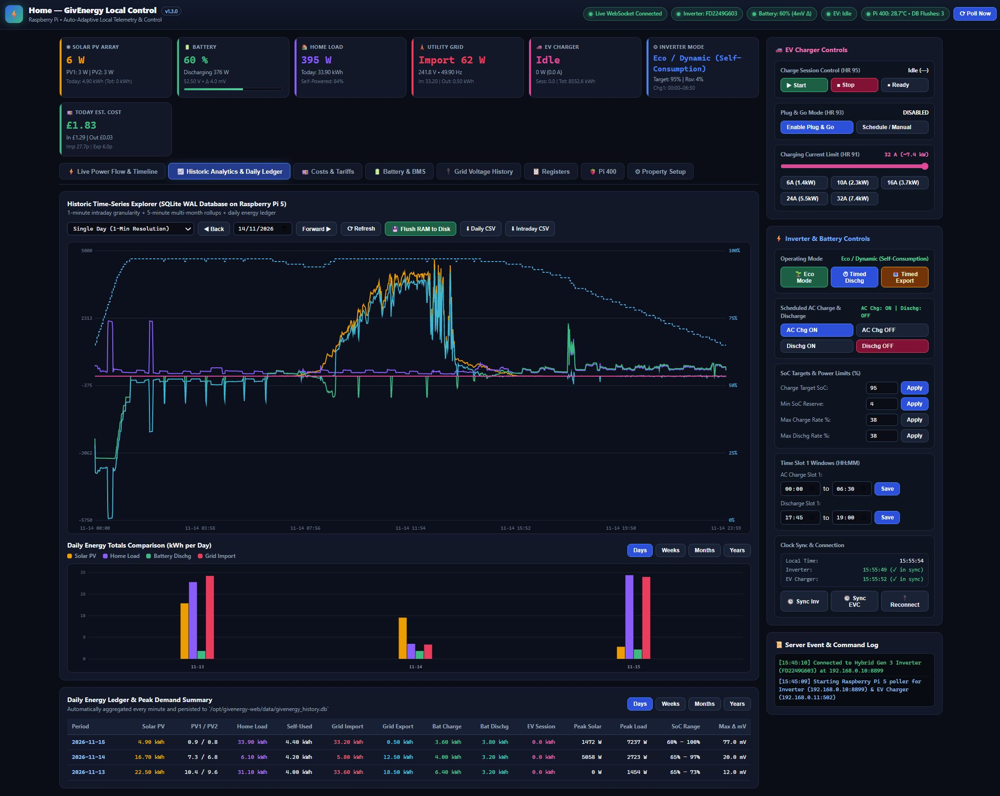
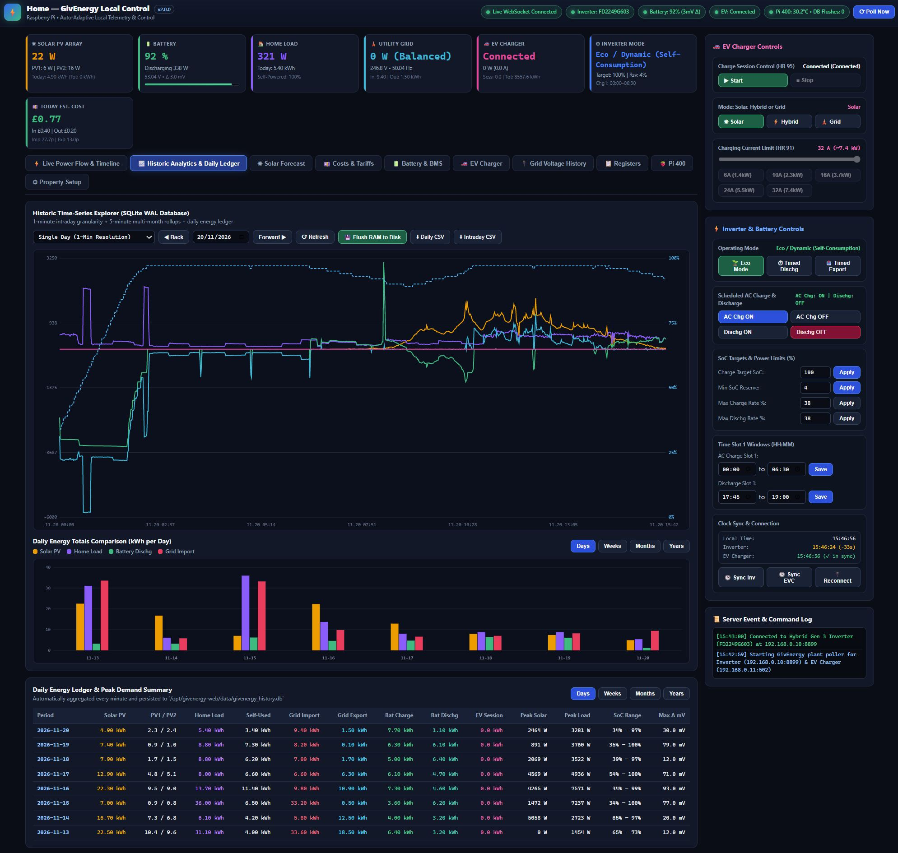
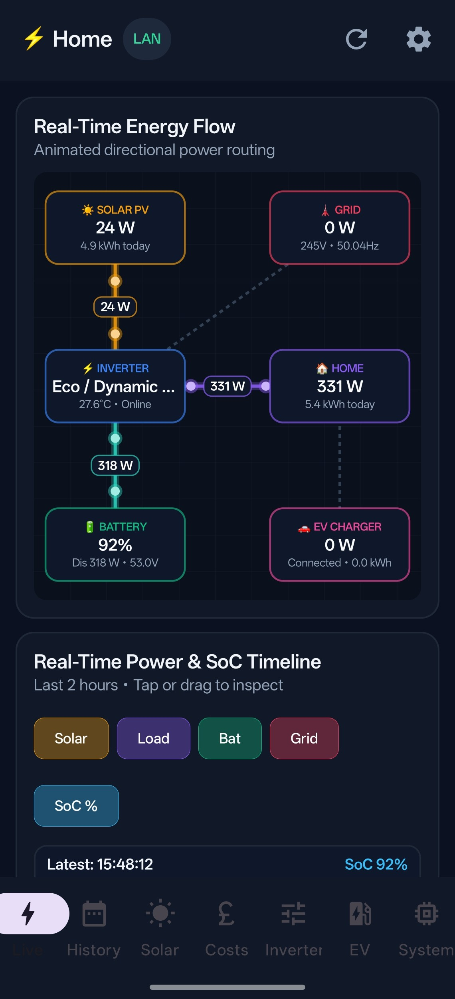
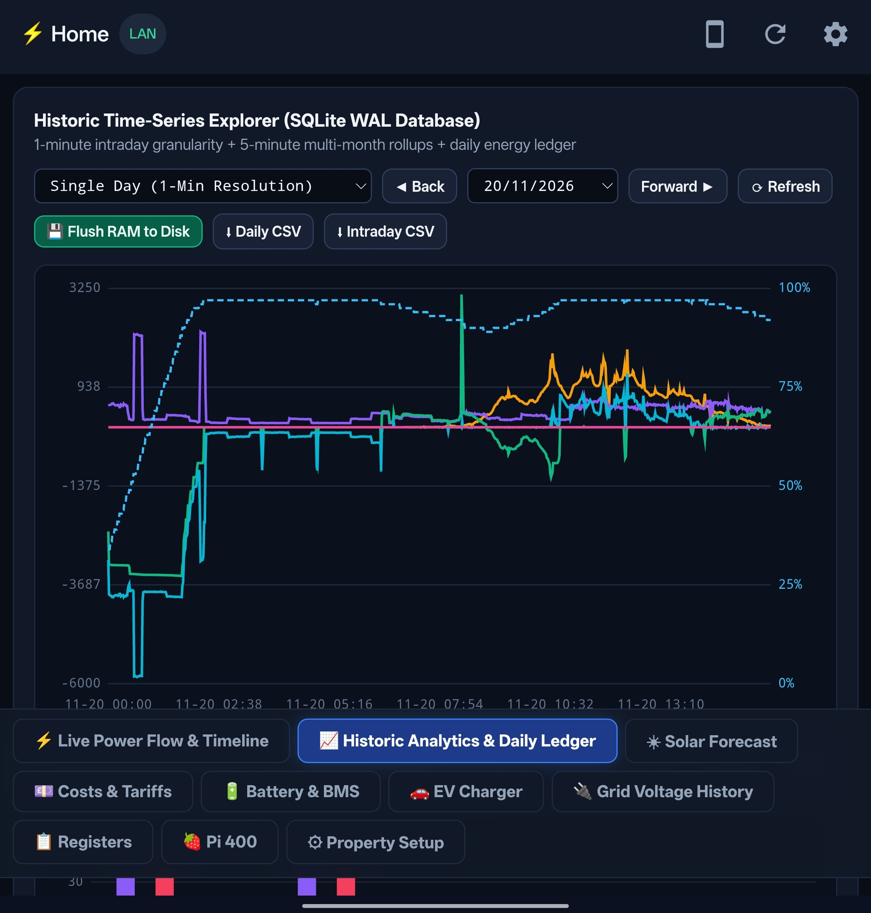

# GivEnergy Local Control (`v2.1.0`)

Local, cloud-free monitoring, control, and historic telemetry server for **GivEnergy Hybrid Inverters, Batteries, and EV Chargers** — running 24/7 on **Raspberry Pi**, **Ubuntu / Debian Linux**, or as a native **Windows Service**, with a **Windows Deployment Wizard**, **Local Linux Installer**, and **Android Companion App**.





---

## Key Features

- **100% Local Modbus TCP Control** — Direct local communication with GivEnergy Hybrid Inverters (`:8899`) and EV Chargers (`:502`) with no cloud dependency.
- **Multi-Platform Hosting (Raspberry Pi, Linux & Windows Service)** — Runs as a `systemd` service on Raspberry Pi OS / Ubuntu / Debian or as a native Windows Service (`GivEnergyLocalControl`), with dual-stack IPv4/IPv6 binding and automatic platform adaptation in the Web UI and Android app.
- **Smart EV Charger Modes (Solar / Hybrid / Grid)** — Dynamic excess-solar EV charging with configurable **Solar Export Split %**, **Max Battery Discharge Power to EV**, automatic Solar start/stop, and schedule-safe full-power operation for timed/overnight tariffs.
- **Real-Time Power Flow & Live Dashboard** — Responsive web UI (desktop & mobile) with WebSocket updates, live power flow schematic (showing house-only Home Demand while keeping EV load in historic totals), KPI cards, double-height 2-hour timeline chart (backfilled from 1-minute SQLite history on startup), configurable polling rate (`5s` / `10s` / `15s` / `30s` / `1m`), and a **Clock Sync & Connection** panel displaying local time alongside Inverter and EV Charger RTC clock drift.
- **Historic Telemetry (Storage-Safe SQLite WAL)** — Configurable RAM-batched writes for MicroSD wear-protection (`60s` flush + volatile journald logs) or NVMe/USB SSD / Windows tuning (`15s` flush + `fstrim`), with **Days / Weeks / Months / Years** energy aggregation views and interactive bar-chart hover tooltips.
- **Battery & BMS + Grid Voltage Views** — Per-cell voltage monitoring, BMS status, and grid voltage history charts.
- **Auto-Discovery & Property Setup** — Automatically scans your local `/24` subnet for GivEnergy Inverters and EV Chargers on first setup and saves configuration to `property_config.json`.
- **UK Energy Cost, EV/Home Breakdown & What-If Comparison** — 3-tier tariff engine supporting Custom Flat/Dual/ToU rates, UK Supplier Presets (E.ON, EDF, British Gas, OVO, Octopus), and Octopus Energy's live half-hourly API with automatic regional Ofgem Price Cap comparison, **Check Tariff** non-destructive cost previews, **Save New Tariff** with effective-date tariff history (using off-peak fallback for partial/missing telemetry), daily **EV Charging Cost** (pricing grid import at the import rate and Solar/Hybrid charging at the export rate) and **Home Cost** (excluding standing charges & EV charging), a full-width **Cost & Export Ledger** with a grouped bar graph across **Days / Weeks / Months / Years / All-Time**, and a **Tariff Comparison (What-If Calculator)** showing both with-export and **No Export** rows.
- **Solar Forecasting (Open-Meteo + Adaptive Efficiency Calibration)** — Hourly & daily solar PV yield forecasts using Open-Meteo Global Tilted Irradiance (`global_tilted_irradiance`), supporting primary and optional second split-roof arrays, Google Maps coordinate paste splitting, and an adaptive site efficiency factor that learns from actual PV telemetry to calibrate future trends. Available in the **☀ Solar Forecast** web tab and the **Solar** tab in the Android app.
- **System Backup & Restore** — Portable `.zip` export and validated import of property, tariff, and solar forecast configurations plus the historic SQLite database for backups or hardware migration.
- **Host System Health & Maintenance Tab** — Automatically adapts to **Raspberry Pi**, **Linux Host**, or **Windows Service** (reporting CPU usage %, CPU temperature where supported, RAM, detected storage type such as MicroSD / NVMe SSD / SSD / HDD, plus GitHub update checks and Linux/Pi OS maintenance actions).
- **Optional Tailscale Remote Access & Funnel** — Guided Tailscale + Tailscale Funnel HTTPS setup with automatic Bearer Token authentication and QR code pairing for secure off-site and Android app access without router port-forwarding or running a VPN client on your phone.
- **Android Companion App (`givenergy-local-control.apk`)** — Native Jetpack Compose Android app for phones, foldables, and tablets with tabs aligned to the Web UI (**Live**, **History**, **Solar**, **Costs**, **Inverter**, **EV**, **System**), live power flow, battery/BMS & grid voltage details, interactive historical time-series graphs with **Prev / Date / Next** interval navigation, Open-Meteo solar forecast trends, **Net / EV / Home / Import / Export / Self-Use** Today boxes and **Cost & Export Ledger** bar graph, one-scan QR pairing, and in-app GitHub release self-updates.
- **Multi-Target Windows Deployment Wizard (`GivEnergy-Local-Control-Installer.exe`)** — Supports remote deployment to Raspberry Pi or Ubuntu/Debian Linux (with OpenSSH guide, per-IP DPAPI credential persistence, target pre-flight checks, and a backup-first **Uninstaller**), as well as **local Windows Service installation** (with IIS/custom port selection, Windows Firewall rule, and **Windows Settings → Apps** uninstall support).

---

## Downloads (`v2.1.0`)

All release packages are available on the [**v2.1.0 Release**](https://github.com/mikekwarner/GivEnergy-Local-Control/releases/tag/v2.1.0):

| Package | Platform | Purpose |
| :--- | :--- | :--- |
| **`GivEnergy-Local-Control-Installer.exe`** | Windows | GUI wizard to deploy remotely to **Raspberry Pi / Linux** or install locally as a **Windows Service** |
| **`GivEnergy-Local-Control-Linux.tar.gz`** | Ubuntu / Debian / Pi OS | Standalone local Linux installer & uninstaller (`install_linux.sh` / `install_linux.py`) |
| **`givenergy-local-control.apk`** | Android | Native Jetpack Compose companion app (phone, foldable, and tablet) |

---

## Quick Start

### Option A: Windows Deployment Wizard (Pi, Remote Linux, or This Windows PC)

1. Download **`GivEnergy-Local-Control-Installer.exe`** from the [**v2.1.0 Release**](https://github.com/mikekwarner/GivEnergy-Local-Control/releases/tag/v2.1.0).
2. Double-click `GivEnergy-Local-Control-Installer.exe`:
   - **Step 1 (Target OS):** Choose **Raspberry Pi**, **Linux PC / Server / VM (Ubuntu / Debian)**, or **This Windows PC (Local Windows Service)** (includes an Optimal Setup Guide for power efficiency and storage longevity).
   - **Step 2 (Prerequisites):**
     - *Raspberry Pi:* Prepare a Raspberry Pi OS Lite SD/SSD card using Raspberry Pi Imager.
     - *Linux:* Guided commands to install/enable OpenSSH Server (`openssh-server`).
     - *Windows:* Checks Administrator elevation, detects IIS (`W3SVC`) / port `80` (offering to replace the Default IIS Web Site or use a custom port such as `8080`), and configures the Windows Firewall rule.
   - **Step 3 *(Pi / Linux)*:** Auto-detect devices on your local network (warns on port `80` conflicts or non-Pi hardware when Pi mode is selected, and includes **Uninstall...** with optional `.zip` backup).
   - **Steps 4–5:** *(Optional)* Pre-configure UK Import/Export Tariffs and Open-Meteo Solar Forecasting.
   - **Step 6 *(Pi / Linux)*:** Enter SSH credentials (remembered per-IP via Windows DPAPI), choose Tailscale remote access, and select storage optimization.
   - **Deploy & Finish:** Installs and starts the service, then opens the dashboard to **⚙ Property Setup** to verify your Inverter and EV Charger IPs.

### Option B: Direct Local Linux Installation

See [README_LINUX.md](README_LINUX.md) for full details:

```bash
tar -xzf GivEnergy-Local-Control-Linux.tar.gz
cd GivEnergy-Local-Control-Linux
chmod +x install_linux.sh install_linux.py
./install_linux.sh
```

---

## Android Companion App

1. Download **`givenergy-local-control.apk`** from the [**v2.1.0 Release**](https://github.com/mikekwarner/GivEnergy-Local-Control/releases/tag/v2.1.0) and install it on your Android device (enable *Install unknown apps* if prompted).
2. Enable **Tailscale Funnel** (or use your local LAN URL) and view your pairing details under **⚙ Property Setup → Remote Access**.
3. Open **GivEnergy Local Control** on your phone/tablet and scan the **QR Code** (or paste your URL and Bearer Token) to pair.

<table>
  <tr>
    <td align="center"></td>
    <td align="center"></td>
  </tr>
</table>

---

## Running or Building from Source

### Windows Installer, Linux Package & Android APK

Run the automated Windows setup script (`setup_dev_env.bat` / `setup_dev_env.ps1`) to create `.venv`, install `requirements.txt`, check Java/JDK & `adb`, and generate `givenergy_android/local.properties`:

```powershell
# 1. Automated Windows environment setup (add -Build to also compile EXE + Linux tarball + APK)
.\setup_dev_env.bat

# 2. Launch the Deployment Wizard from source
.\deploy_wizard.bat

# 3. Build all release artifacts into dist\
.\build_wizard_exe.bat
```

### Android Companion App (`givenergy_android/`)

Requires **Android Studio** (or **Gradle** + **JDK 17** and Android SDK `compileSdk = 37`, `minSdk = 24`):

```powershell
cd givenergy_android
gradle assembleDebug
# Output: givenergy_android\app\build\outputs\apk\debug\givenergy-local-control-debug.apk
```

---

## Network Ports Used

| Port | Protocol | Purpose |
| :--- | :--- | :--- |
| `80` *(or custom)* | HTTP / WebSocket | GivEnergy Local Control Web Dashboard (`givenergy-web.service` / `GivEnergyLocalControl`) |
| `22` | SSH / SFTP | Remote provisioning and deployment from the Windows Installer (Pi / Linux) |
| `8899` | TCP (Modbus) | GivEnergy Hybrid Inverter local communication |
| `502` | TCP (Modbus) | GivEnergy EV Charger local communication |

---

## Repository Structure

- `wizard.py` — PySide6 Multi-Platform Deployment & Local Windows Service Installer GUI
- `windows_service.py` & `deploy_windows.py` — Native Windows Service host (`advapi32` SCM), IIS/port handler, and Windows Settings uninstaller
- `deploy_to_pi.py`, `setup_pi.py` & `uninstall_pi.py` — Remote Raspberry Pi / Linux SSH/SFTP provisioning, `systemd` deployment, and backup-first uninstaller
- `install_linux.py`, `install_linux.sh` & `README_LINUX.md` — Standalone local Linux installer & uninstaller
- `givenergy_web/` — Modular FastAPI + WebSocket backend (`create_app()`, `routes/`, `platform_adapter.py`, `context.py`, `db_utils.py`), async Modbus poller, SQLite WAL database, and web UI (`static/index.html`)
- `givenergy_android/` — Native Kotlin / Jetpack Compose Android companion app (`givenergy-local-control.apk`)
- `build_linux_pkg.py` & `build_wizard_exe.bat` — Build scripts for `GivEnergy-Local-Control-Installer.exe`, `GivEnergy-Local-Control-Linux.tar.gz`, and `givenergy-local-control.apk`
